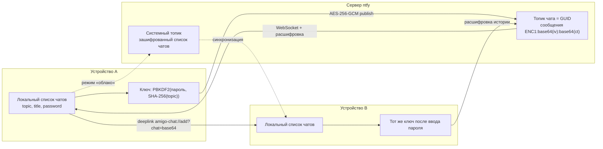

# Ntfy Chat — Android-клиент

Нативное Android-приложение (Kotlin + Jetpack Compose) — чаты поверх
[ntfy](https://docs.ntfy.sh/). Каждый чат — это **топик ntfy**.

## Как устроены чаты

- **Чат = топик ntfy.** Имя топика — уникальный **GUID**
  (`UUID.randomUUID()`), например `3f1c2e9a-....`.
- **Первое сообщение** топика — заголовок чата в формате Markdown:
  `#название чата`. Из него берётся название при отображении.
- **Остальные сообщения** отправляются в тот же топик с включённым
  Markdown (`markdown: true`): `**жирный**`, `*курсив*`, `` `код` ``,
  заголовки, списки, ссылки — и рендерятся в приложении.
- Список чатов хранится **локально на устройстве** (ntfy не даёт списка
  топиков — их нельзя перечислить с сервера).
- Свои сообщения помечаются тегом `me-<device_id>` (GUID устройства),
  чтобы отличать их в ленте.

## Схема работы



Как читать схему:
- **Чат = топик ntfy**, имя топика — случайный GUID (фактически пароль доступа).
- **Пароль чата** (у каждого свой) через PBKDF2 даёт ключ AES-256-GCM; соль —
  `SHA-256(topic)`, поэтому одно и то же слово на разных чатах даёт разные ключи.
- Сообщения уходят на сервер только как `ENC1:...`; входящие расшифровываются
  ключом чата (WebSocket — реалтайм, `/json` — история).
- **Контакты/список** передаются диплинком `amigo-chat://add?chat=<base64>`
  (сервер, топик, название; **пароль не включается** — получатель вводит его
  вручную).
- **Системный топик** — отдельный топик с зашифрованным снимком всего списка
  чатов. В режиме «облако» он публикуется/синхронизируется, в режиме «локально»
  список не покидает устройство.

## Возможности

- Настройка сервера ntfy (по умолчанию `https://ntfy.sh`) и необязательного
  access token.
- Создание чата: генерируется GUID-топик, публикуется `#название`.
- Список чатов: название, последнее сообщение, счётчик непрочитанных, время.
- Переписка: история (`since=all`), реалтайм по WebSocket, отправка.
- Рендер Markdown (заголовки, жирный, курсив, код, списки, цитаты, ссылки).
- Шифрование чата паролем (AES-256-GCM), ввод пароля при входе в чат.
- Добавление чата по ссылке/топику, «поделиться чатом».
- Удаление чата из локального списка, тёмная тема.

## Шифрование чата паролем

- **Все чаты шифруются.** При создании можно задать пароль; если оставить поле
  пустым — генерируется случайный пароль (24 байта) и ключ сохраняется на
  устройстве, так что вводить его не нужно.
- **У каждого чата свой пароль** и свой ключ (соль = SHA-256 топика). Пароль
  чата хранится локально и виден в шапке чата (кнопка с ключом); попадает в
  «поделиться».
- Ключ хранится локально (обёрнут мастер-ключом из Android Keystore); при входе
  в чужой зашифрованный чат приложение просит пароль.
- «Поделиться» формирует диплинк
  `amigo-chat://add?chat=<base64url(JSON)>` (сервер, топик, название, пароль).
  Открытие диплинка добавляет чат и сразу открывает его.
- Незашифрованные топики при добавлении по ссылке отклоняются; старые
  незашифрованные чаты удаляются из списка при запуске.
- Алгоритм (совместим с веб-фронтом):
  - ключ: PBKDF2-HMAC-SHA256, **600 000 итераций**, соль = SHA-256(topic), 256 бит;
  - шифр: AES-256-GCM, случайный 12-байтовый IV, тег 128 бит;
  - формат: `ENC1:` + base64(iv) + `:` + base64(ciphertext||tag).
- Пользовательский пароль при создании — **минимум 12 символов**; пустой пароль
  заменяется сгенерированным (24 байта). Пароль **не попадает в диплинк**.
- Неверный пароль определяется по провалу аутентификации GCM.
- Зашифрованные сообщения без ключа показываются как «🔒 Зашифрованное
  сообщение», превью в списке — «🔒 Зашифровано».

## Сборка

```bash
cd /home/amigo/mobile
make debug        # APK: app/build/outputs/apk/debug/app-debug.apk
make install      # установить на телефон (adb)
make run          # собрать и установить
make help         # все команды
```

Через Gradle: `./gradlew assembleDebug`.

Сервер и токен задаются уже в приложении на экране настройки (или через
иконку шестерёнки в списке чатов).

## Стек

- Kotlin 2.0.21, Jetpack Compose (Material 3), minSdk 26 / target 35
- MVVM + StateFlow, Hilt, Navigation Compose
- OkHttp (HTTP + WebSocket), kotlinx.serialization, DataStore, Coil

## Структура

```
app/src/main/java/ru/amigo/chat/
├── AmigoApp.kt                         # @HiltAndroidApp
├── MainActivity.kt                     # настройки -> чаты -> переписка
├── data/
│   ├── local/Prefs.kt                  # DataStore: сервер, токен, список чатов, device_id
│   ├── model/ChatModels.kt             # LocalChat
│   ├── remote/ntfy/
│   │   ├── NtfyDtos.kt                 # NtfyMessage, NtfyPublishRequest
│   │   └── NtfyClient.kt               # publish / history / WebSocket
│   └── repository/ChatRepository.kt
├── di/AppModule.kt                     # Json, Prefs, OkHttpClient
├── ui/
│   ├── SessionViewModel.kt
│   ├── setup/                          # сервер + токен
│   ├── chats/                          # список чатов
│   ├── chat/                           # переписка
│   └── theme/
└── util/                               # Markdown-рендер, время, ошибки
```

## Системный топик

- Отдельный топик хранит **зашифрованный паролем список чатов** (топик, название,
  пароль каждого чата, время прочтения). Он **не показывается в общем списке** —
  доступен на отдельном экране (иконка «облако» в списке чатов).
- Экран: создать системный топик (пароль), подключиться к существующему (топик +
  пароль), «Опубликовать» и «Синхронизировать» локальный список.
- **Выбор режима хранения списка**: «Локально» (по умолчанию) или «В облаке»
  (системный топик). В облачном режиме список публикуется при изменениях и
  синхронизируется при запуске; в локальном — не отправляется.
- Список автоматически публикуется в системный топик при создании, добавлении и
  удалении чатов (в облачном режиме).
- Это перенос списка между устройствами: на новом устройстве подключаетесь тем же
  топиком и паролем — чаты добавляются локально с ключами.

## Используемые endpoint'ы ntfy

| Действие | Запрос |
|----------|--------|
| Публикация (JSON) | `POST {server}/` c `{"topic","message","markdown":true,"tags":[...]}` |
| История / poll | `GET {server}/{topic}/json?poll=1&since=all` |
| Реалтайм | `WS {server}/{topic}/ws?since=all` |
| Авторизация | `Authorization: Bearer <token>` |

## Безопасность

Сделано:
- пароль не передаётся в диплинке (ссылка + пароль — разными каналами);
- только длинные пароли: пользовательский ≥ 12 символов, иначе — сгенерированный
  (24 байта);
- PBKDF2-SHA256 600 000 итераций;
- ключ каждого чата хранится локально, на Android — обёрнут Android Keystore;
- сервер хранит только шифротекст; поддерживается access token ntfy.

Осталось для строгой модели (не реализовано):
- **серверный ACL**: свой ntfy с токенами и отключённым логированием метаданных
  (настраивается на стороне сервера; приложение уже умеет `Authorization: Bearer`);
- **аутентификация отправителя**: подпись сообщений (Ed25519) и проверка ключом;
- **forward secrecy**: ratchet/Double Ratchet — крупная переработка протокола;
- метаданные ntfy (время, размер, теги `me-<device_id>`) серверу видны.

## Ограничения

- Топики ntfy нельзя перечислить — список чатов ведётся локально, поэтому на
  другом устройстве его нужно создавать/добавлять заново.
- Нет аккаунтов: любой, кто знает GUID-топик, может читать и писать. Топик —
  фактически пароль, используйте длинный GUID (приложение так и делает).
- Реалтайм — WebSocket; при обрыве переподключение выполняет OkHttp-клиент.
- Спецсимволы ntfy в топике допускаются только `[-_A-Za-z0-9]`
  (GUID с дефисами подходит).
